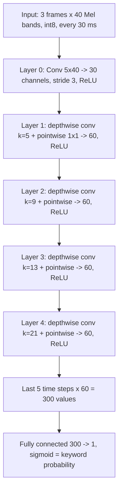

# Wake Word Model Architecture

This document describes the neural network that `sof_mww_train_pcan.py`
trains for the microWakeWord (MWW) component. All keyword models trained with
these tools use the same network; only the weights differ.

The network is a small streaming 1-D convolutional network that convolves
only along time. It is a simplified version of the open-source microWakeWord
"MixedNet" design and is defined in `build_mww_model()`.

## Input

Every 10 ms the SOF MFCC component produces one frame of 40 Mel band values,
normalized by PCAN and stored as int8. The network runs every 30 ms on the
three newest frames, so its input is 3 x 40 int8 values.

## Layers

- **Layer 0** looks at 5 frames (50 ms) across all 40 Mel bands. It turns
  the spectrum into 30 learned features per time step and moves forward 3
  frames each time, so one output step is 30 ms.
- **Layers 1-4** are depthwise-separable convolutions, the same building
  block as in MobileNet:
  - The depthwise part filters each channel along time on its own, with
    kernels of 5, 9, 13 and 21 steps.
  - The pointwise 1x1 part then mixes the channels.
  - The growing kernels let each layer see more context: about 150, 270, 390
    and 630 ms of feature history.
- **Final layer:** combines the last 5 time steps of 60 features and produces
  one number, which the sigmoid turns into a keyword probability from 0 to 1.
- **"MixConv" naming:** the original MixConv design mixes several kernel
  sizes inside one layer. This version uses one kernel size per layer, so the
  name comes from its origin rather than the exact structure.

## Context and Size

| Item | Value |
|---|---|
| How far back it looks (receptive field) | 149 frames, about 1.5 s; the keyword must fit in this |
| Weights | about 22 k parameters (conv0 6 k, the four separable layers about 15.7 k, final layer 301) |
| Multiply-adds per inference | about 22 k |
| State kept between inferences | 6 buffers, about 2.8 kB as int8 |
| Model blob | about 50 kB (weights, quantization parameters and the operator graph) |

## Streaming

- **Training:** done offline on 1.6 s windows (160 frames). Each layer has
  zero padding at its start, so it only uses past frames. This padding equals
  the zero initial state of the streaming model.
- **Conversion for the firmware:** `build_streaming_inference_model()`
  rebuilds the network in a streaming form. Each layer keeps a buffer of its
  last *k-1* inputs, so each 30 ms step computes only the newest output column
  instead of the whole 1.5 s window. These buffers are the streaming state.
  `sof_mww_int8_state.py` converts them to int8.
- **Folding:** batch normalization is merged into the convolution weights,
  and dropout (30 %, used only during training) is removed.
- **Quantization:** the whole graph runs in int8 with TensorFlow Lite Micro,
  with the HiFi4 nnlib kernels on the DSP. The input scale is pinned to the
  firmware PCAN int8 mapping (scale 666/256, zero point -128).
- **Calibration:** the int8 ranges of the other tensors are taken from
  training windows streamed through the model. The calibration set must
  contain keyword windows. Otherwise the output range is too narrow and the
  probability saturates below 1.0, so every keyword peaks at the same value.

## Training and Trigger

- **Loss:** binary cross-entropy, keyword = 1 and everything else = 0. The
  negative class weight (`--class-weight-neg`, default 3.0) makes false
  triggers cost more than missed keywords.
- **Negative data:** ambient noise and cafeteria babble, single words
  (`unknown`), synthesized competing wake phrases, continuous sentence speech
  (`speech`), digital silence and synthetic clicks.
- **Trigger rule:** the firmware triggers when the average of the last
  `--avg-len` probabilities (default 4, about 120 ms) reaches `--threshold`
  (default 0.5). The trainer stores both in the model blob header, so the
  firmware uses the same rule as the evaluation report.

## Cost on the DSP

About 22 k multiply-adds every 30 ms is very little arithmetic. Per-operator
cycle profiling (`CONFIG_COMP_MWW_PROFILE`) shows far more cycles per
operator than the multiply-adds need. Most of the DSP load is therefore
probably per-operator overhead in TensorFlow Lite Micro rather than math.
